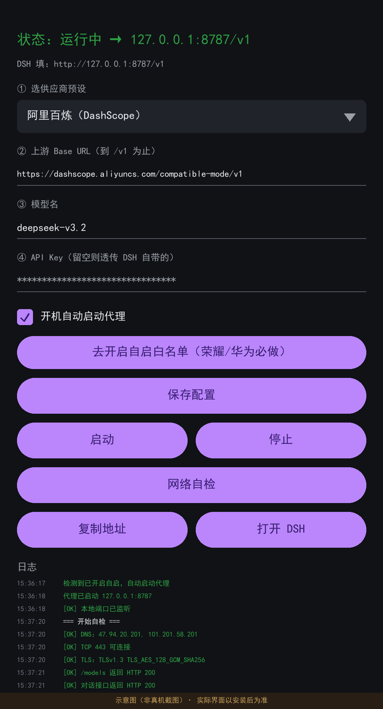

# DSH Proxy

一个跑在 Android 上的**本地 API 中转代理**，用于修复上游 SSE 流里的 `usage: null` 导致端侧 AI 助手解析报错的问题。

## 本项目的由来

这是一个**配套工具**，不是独立产品。它诞生于使用 [**jackwener/DSH-Android**](https://github.com/jackwener/DSH-Android)
（一个把 DeepSeek Harness 打包成 APK、免 ROOT 免 Termux 在手机上跑的开源项目）时遇到的实际问题。

感谢 [@jackwener](https://github.com/jackwener) 的开源工作 —— 没有 DSH-Android 就没有这个工具。

> 本项目与 DSH-Android 作者无关，也未获得其官方背书。DSH-Android 本身遵循 Apache-2.0 协议。

## 它解决什么问题

```
客户端 (DSH)  ──►  127.0.0.1:8787 (本 App)  ──►  上游供应商 API
                        │
                        └─ 剥离 SSE 帧里的 "usage": null
```

某些「OpenAI 兼容」供应商在流式响应的**每一帧**都带 `"usage": null`。部分客户端解析时只判断了
`usage === undefined`，遇到 `null` 就去读 `usage.prompt_tokens`，直接抛 `TypeError`，
整条流被判定为传输失败，表现为：

```
provider transport failed / TRANSPORT
```

本 App 逐事件扫描 SSE 流，删掉值为 `null` 的 `usage` 键，**保留末帧真实的 usage 对象**和 `[DONE]` 标记，
再把干净的流原样吐回客户端。客户端只需把 Base URL 指向 `http://127.0.0.1:8787/v1` 即可。

## 功能

- **本地代理**：原生 `ServerSocket` 实现 HTTP/1.1（不依赖 NanoHTTPD），支持
  - `Content-Length` 与 `Transfer-Encoding: chunked` 两种请求体
  - `Expect: 100-continue`（不回 100 会与客户端互等死锁）
  - SSE 流式逐事件转发，不做整体缓冲
- **供应商预设**：阿里百炼 / DeepSeek / OpenAI / 智谱 / ModelScope / 自定义
- **网络自检**：DNS → TCP → TLS → `/models` → 直连对话 → **经本地代理端到端**（并校验 `usage:null` 是否已清除）
- **前台服务常驻**，支持开机自启（需系统白名单，见下）
- **打开即自启**：打开 App 时若检测到已开启自启且代理未运行，自动拉起

## 界面



> 上图为界面示意图（标注了「示意图」水印），用于说明布局与元素顺序；实际界面以安装后为准。

主界面自上而下依次是：

| 区块 | 说明 |
|---|---|
| 状态栏 | 绿色=运行中，红色=未运行；显示 `127.0.0.1:8787/v1` |
| DSH 填 | 提示客户端该填的本地地址 |
| ① 供应商预设 | 下拉选择，选中后自动填充下面两项 |
| ② 上游 Base URL | 到 `/v1` 为止，例如 `https://dashscope.aliyuncs.com/compatible-mode/v1` |
| ③ 模型名 | 按供应商控制台的实际名称填 |
| ④ API Key | 密码框；留空则透传客户端自带的 Key |
| 开机自启开关 | 勾选后开机/打开 App 自动启动代理 |
| 去开启自启白名单 | 荣耀/华为用户必做，跳转系统「应用启动管理」 |
| 保存配置 / 启动 / 停止 | 基本操作 |
| 网络自检 | 五级链路检查 + 经代理端到端验证 |
| 复制地址 / 打开 DSH | 把 `http://127.0.0.1:8787/v1` 复制到剪贴板；跳转 DSH |
| 日志 | 运行日志，含每个请求的方法、路径、body 大小、上游状态码 |

## 构建

需要 JDK 17+ 与 Android SDK（compileSdk 35 / build-tools 35.0.0）。

```bash
# 1) 指定 SDK 路径
echo "sdk.dir=/path/to/android-sdk" > local.properties

# 2) 构建 debug APK
./gradlew :app:assembleDebug
# 产物：app/build/outputs/apk/debug/app-debug.apk

# 3) 跑单元测试（9 个用例覆盖 SSE 清洗逻辑）
./gradlew :app:testDebugUnitTest
```

Windows 用 `gradlew.bat`。

## 使用

1. 安装 APK，打开 App。
2. 选择供应商预设，**填入你自己的 API Key**，勾选「开机自动启动代理」，点**保存配置**。
3. 点**启动**，状态栏变绿即 `127.0.0.1:8787` 已就绪。
4. 在 DSH 里把模型服务的 Base URL 填成 `http://127.0.0.1:8787/v1`，模型名按供应商实际名称填。

### 关于 API Key

- **Key 由使用者自己提供**，代码里没有任何硬编码的密钥。
- Key 只存在你手机本地，使用 `EncryptedSharedPreferences`（AES-256）加密保存。
- 代理转发时以 `Authorization: Bearer <你的Key>` 注入上游请求；若客户端自己带了 `Authorization`，则优先透传客户端的。
- App 内 Key 留空时，代理会透传客户端（DSH）自带的 Key。

### 开机自启（荣耀 / 华为必做）

荣耀、华为等 ROM 默认拦截第三方 App 的 `BOOT_COMPLETED` 广播，**App 自身无法绕过**（这是系统级限制）。
点 App 里的**「去开启自启白名单」**按钮，在系统「应用启动管理」中把本 App 改为**手动管理**，并打开：

- 允许自启动
- 允许关联启动
- 允许后台活动

不设置也能用 —— 打开 App 时会自动启动代理，只是**重启手机后需要手动打开一次 App**。

## 已知限制

- **无法强制停止其他 App**。`FORCE_STOP_PACKAGES` 是 signature 级权限，普通 App 拿不到，
  所以本 App **不提供**「重启 DSH」这类功能（早期版本有，但做不到，已移除）。
- **推理型模型响应慢属正常**。如 `deepseek-v4.1-flash` 这类思考模型，复杂问题可能思考 1 分钟以上，
  界面显示等待不代表代理卡死（代理侧通常 1 秒内就返回 200 并持续流式推送）。
- **只处理 `usage: null`**。若上游有其它非标准字段导致客户端报错，本 App 不会处理。
- **不替代供应商 SDK**。它只是个透传代理，不做重试、不做多 key 轮询、不做计费统计。
- **明文 HTTP 仅限回环**。`network_security_config.xml` 只对 `127.0.0.1` / `localhost` 放行明文，
  其他域名仍强制 HTTPS。
- **代理只监听 `127.0.0.1`**，不对局域网或外网暴露。
- **需要 Android 8.0+**（minSdk 26）。

## 技术要点

### 为什么不用 NanoHTTPD

早期版本用过 NanoHTTPD，但它的 `parseBody()` 有三个硬伤：

1. 不支持 `Transfer-Encoding: chunked`（读到空 body，最终回 500）
2. 不处理 `Expect: 100-continue`（客户端等 100、服务端等 body，互等死锁）
3. 会对 body 做 `.trim()`，且 Content-Type 缺失时按 US-ASCII 解码

因此改为原生 `ServerSocket` 自行实现 HTTP/1.1。

### 其他实现细节

- OkHttp dispatcher 上调至 128/64，避免慢响应并发超过默认 `maxRequestsPerHost=5` 后阻塞排队
- 工作线程池有界（4~16 线程、队列 128），满则回 503 且不阻塞 accept 循环
- 读请求阶段 `soTimeout` 30s，防止半开连接长期占用线程
- 响应体上限 16MB，超限回 413
- 上游 `Content-Type` 会过滤 CR/LF，防止响应头注入

## 测试

`app/src/test/java/com/dshproxy/app/SseFixTest.kt` 包含 9 个用例，覆盖：

- `usage:null` 被剥离、末帧真实 usage 保留、`[DONE]` 保留
- 逐字节分片与整体喂入输出一致
- CRLF 换行兼容
- 无 `usage` 字段时原样透传
- 多行 `data:` 事件拼接
- 错误响应体原样透传
- 复现原 bug（对照组）并验证修复

## License

MIT，见 [LICENSE](LICENSE)。
